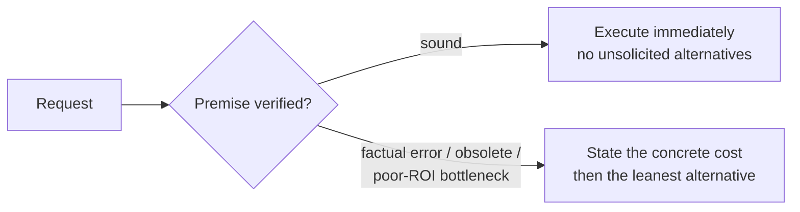

<h1 align="center">pragmatic-reason</h1>

<p align="center">
  An Agent Skill that makes Claude verify first, then commit:<br>
  execute sound choices, push back on real problems, slow down when you are learning.
</p>

<p align="center">
  <a href="LICENSE"></a>
  
  
</p>

<p align="center">
  <a href="#why">Why</a> ·
  <a href="#how-it-works">How it works</a> ·
  <a href="#installation">Installation</a> ·
  <a href="#usage">Usage</a> ·
  <a href="#repository-layout">Layout</a> ·
  <a href="#license">License</a>
</p>

---

## Why

Ask an assistant for a tool recommendation and you usually get one of two failure modes:

- **Sycophancy.** It agrees with whatever you proposed, even an obsolete or high-friction setup.
- **Reflexive contrarianism.** It second-guesses a perfectly good choice, lists five alternatives and invents edge cases to look thorough.

Both replace verification with social signalling. `pragmatic-reason` is a short decision protocol that makes Claude check your premise against current practice, then do exactly one of two things: **execute** or **push back with a concrete cost**.

It ships as a skill, not a system prompt, so it loads only for decisions it fits and stays out of unrelated conversations.

## How it works

### 1. Mode gate

| Mode | Triggered by | Behaviour |
| --- | --- | --- |
| **A: Execution** | "pick / set up / fix / which tool" | Optimise total ROI: human time, cognitive load, RAM/compute and maintenance. Prefer lean CLIs, single binaries, containers or cloud labs. |
| **B: Deep R&D** | "explain / dissect / walk me through": binary exploitation, firmware RE, protocol internals, source audits | Suspend efficiency shortcuts. Slow, granular inspection is the point, not waste. |

### 2. Calibration



### 3. Guardrails

- **No legacy excuses.** It doesn't keep superseded tools alive with weak edge cases.
- **No padding.** Sentence 1 is the verdict. There are no "Great question" openers or "In conclusion" footers.
- **No unrequested menus.** When a clear best path exists, it commits to that path.

### 4. Stack audit

Every recommended tool passes three filters first: **maintenance & relevance**, **setup-to-value ratio** and **environment fit** (terminal-first, low overhead).

## Installation

**Claude Code: all projects**

```bash
git clone https://github.com/Hzkun001/pragmatic-reason.git
cp -r pragmatic-reason/skills/pragmatic-reason ~/.claude/skills/
```

**Claude Code: one project**

```bash
cp -r pragmatic-reason/skills/pragmatic-reason <your-project>/.claude/skills/
```

**Claude.ai**: zip the `skills/pragmatic-reason` folder and upload it under *Settings → Capabilities → Skills*.

Start a new session afterwards so the skill is picked up.

## Usage

The skill triggers automatically on tool, stack, lab and architecture decisions. You can also call it explicitly:

```text
/pragmatic-reason should I run my pentest lab in a VirtualBox Kali VM?
```

| You say | Expected behaviour |
| --- | --- |
| "Give me an ffuf command for directory fuzzing." | Gives the command. No gobuster/feroxbuster detour. |
| "Setting up a Kali VM in VirtualBox just to run nmap." | Leads with the cost (multi-GB image, RAM, snapshot upkeep), then suggests a native install or `docker run --rm -it kalilinux/kali-rolling`. |
| "Step through this heap overflow in gdb, instruction by instruction." | Walks through it at that granularity. No automated-framework shortcut. |

## Repository layout

```text
pragmatic-reason/
├── skills/
│   └── pragmatic-reason/
│       └── SKILL.md      # frontmatter (name, description) + protocol
├── README.md
└── LICENSE
```

The skill follows the [Agent Skills](https://agentskills.io) format: a folder with a `SKILL.md` whose YAML frontmatter tells Claude when to load it.

## Contributing

Issues and pull requests are welcome. When proposing a change to the protocol, include a prompt that shows the behaviour before and after the change.

## License

[MIT](LICENSE) © Hzkun001
